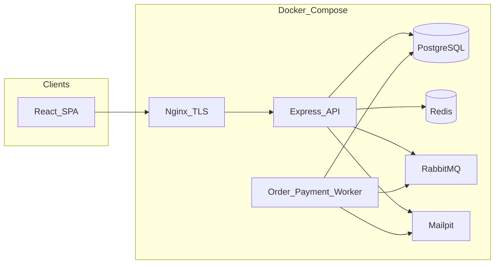
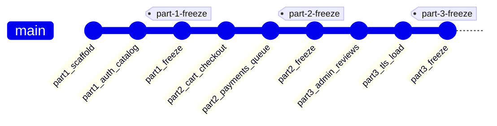
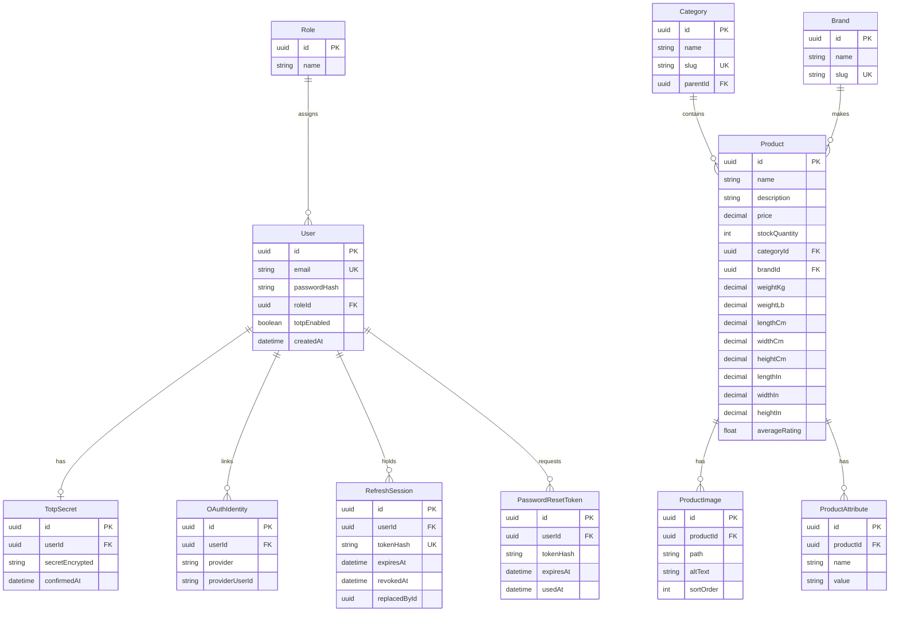
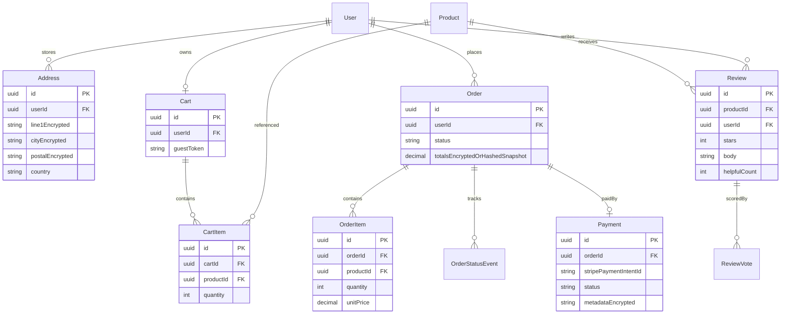
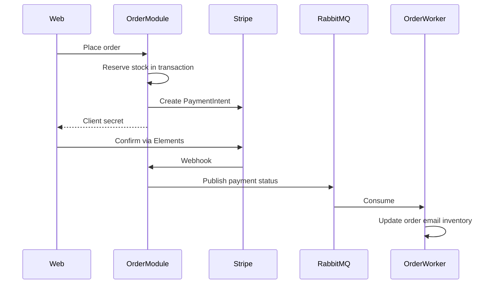

# I Love Shopping — Master Plan and Progress Board

Living source of truth for the three-part B2C e-commerce platform. Tick checkboxes when a item is **demoable in Docker**, not when the first stub exists. Copy this file into each later repo; update the header when you freeze and copy.

| Field | Value |
| --- | --- |
| **Current repo** | `i-love-shopping2` |
| **Current part** | 2 — Commerce |
| **Product category** | Electronics and Technology |
| **Store name (working)** | Volt & Co |
| **Architecture** | Modular monolith (API + web; Part 2 adds a worker) |
| **Last freeze** | `part-2-freeze` (this repo) |

## Current focus (next 3 bites)

1. Practice the Part 2 demo script (guest cart, Stripe, Mailpit, oversell, queue)
2. Oral: explain cart, checkout, and payment tests (`docker compose exec api pnpm test`)
3. After review: copy this freeze into `i-love-shopping3` — do not start Part 3 features here

Copied from Part 1 freeze. Commerce is implemented here (`./scripts/start.sh` → http://localhost:8088). Do not push Part 3 commits into this repo, and do not push Part 2 commits back to `i-love-shopping1`.

---

## 1. How to use this document

- **Progress:** `- [ ]` open, `- [x]` done and reviewable.
- **Freeze rule:** when a part’s **Mandatory** section is fully ticked, tag and push that repo, then copy the tree into the next repo. Do not keep adding later-part features into an already-frozen repo.
- **Review prep:** each part has a demo script. Practice it before reviewers clone.
- **Scope discipline:** design the full data model now; **migrate tables only when that part needs them**.

---

## 2. Product vision

Build a Business-to-Consumer electronics shop: headphones, laptops, phones, accessories, and home tech. Customers register or sign in with Google, browse a faceted catalog, and (in later parts) check out with Stripe sandbox payments. Admins (Part 3) run catalog, orders, users, and reviews.

Why electronics: facets are obvious (brand, category, price, rating, specs), images matter, and stock/oversell stories are easy to demo.

Brand tone: clean, trustworthy, not gimmicky. First impression is “I would actually buy this,” not “student project with rainbow buttons.”

---

## 3. Stack (locked for all three repos)

| Layer | Choice |
| --- | --- |
| API | Express + TypeScript |
| Web | React 19 + Vite |
| ORM / DB | Prisma + PostgreSQL (ACID transactions) |
| Sessions / cache | Redis (refresh tokens; later rate limit + search cache) |
| Queue (Part 2+) | RabbitMQ |
| Payments (Part 2+) | Stripe sandbox + Stripe.js / Elements (no card data on the server) |
| Mail | Nodemailer + Mailpit in Docker |
| Monorepo | pnpm workspaces: `apps/api`, `apps/web` (Part 2 adds `apps/worker`) |
| Validation | Zod in `packages/shared` (client + server) |
| Tests | Vitest (unit) + Supertest (API) + later Playwright for critical flows; k6 load tests in Part 3 |
| Auth hashing | Argon2 |
| 2FA | TOTP (Google Authenticator / Authy compatible) |
| CAPTCHA | Google reCAPTCHA (use Google’s published test keys in Docker) |
| OAuth | Google (required). Facebook is optional extra; skip unless time remains |
| Images | Disk/volume in Part 1; multiple derived sizes in Part 3 |

Reuse **patterns** from the wellness apps (JWT rotation, Redis refresh, TOTP, Mailpit, Compose one-shot start). Do **not** copy NestJS code into Express.

---

## 4. Architecture

Modular monolith, not microservices. Order and Payment are **modules plus worker processes** that talk over RabbitMQ. That matches the Part 2 service diagram, keeps one-command Docker, and is straightforward to explain in review.



Notes:

- Part 1 Compose: API, web, Postgres, Redis, Mailpit. **No RabbitMQ, no Nginx TLS, no worker.**
- Part 2 adds RabbitMQ + `apps/worker`.
- Part 3 adds Nginx with a self-signed TLS certificate in front of the stack.

### Why this scales (talking points for review)

- PostgreSQL: row-level locking, transactions, indexes, read replicas later, partitioning by order date later.
- Redis: hot session and rate-limit data off the primary DB.
- Modular packages inside one API so catalog, auth, cart, and orders can be split later if needed.
- Worker processes scale independently of HTTP when payment/order volume spikes.
- Caching (search facets, product reads) can be added without rewriting the schema.

### ACID (talking points for review)

- **Atomicity:** placing an order, decrementing stock, and writing payment intent happen in one transaction or roll back together.
- **Consistency:** stock cannot go negative; order totals match line items; FK constraints hold.
- **Isolation:** concurrent checkouts use `SELECT FOR UPDATE` (or equivalent) so two buyers cannot oversell the last unit.
- **Durability:** committed orders survive process crash; Postgres WAL + volume mounts in Docker.

---

## 5. Three-repo workflow (freeze, copy, push)

Live development always happens in **the current part’s repo**. Reviewers of Part 1 must never clone a tree that already has cart/checkout.



### Part 1 freeze (`i-love-shopping1`)

1. All Part 1 **Mandatory** boxes ticked and demoed in Docker.
2. `git tag part-1-freeze` and push this remote.
3. Stop feature commits in this repo (docs/typo fixes only if reviewers demand them).

### Bootstrap Part 2 (`i-love-shopping2`)

```bash
# from parent folder, after Part 1 is frozen and pushed
git clone <i-love-shopping1-url> i-love-shopping2
cd i-love-shopping2
git remote rename origin shopping1-archive   # keep history; do not push Part 2 here
git remote add origin <i-love-shopping2-url>
# update this file header: Current repo = i-love-shopping2, Current part = 2
git push -u origin HEAD
```

Tag `part-2-freeze` when commerce is review-ready. This tree is at that freeze: later-part features belong in `i-love-shopping3`.

### Bootstrap Part 3 (`i-love-shopping3`)

Same pattern from the frozen Part 2 tree. Tag `part-3-freeze` when experience + load report are review-ready.

This file travels with each copy so later repos still have the full checklist.

---

## 6. Target folder layout

Part 1:

```
i-love-shopping1/
  PROJECT_MASTER_PLAN.md    # this file
  README.md
  docker-compose.yml
  scripts/start.sh
  package.json              # pnpm workspace root
  apps/api/                 # Express + Prisma
  apps/web/                 # React + Vite
  packages/shared/          # Zod schemas, shared types
  docs/erd.md               # mermaid ERD embedded in README too
```

Part 2 adds:

```
  apps/worker/              # RabbitMQ consumers (order + payment)
```

Part 3 adds:

```
  nginx/                    # TLS terminator, self-signed cert
  load-tests/               # k6 scenarios
  docs/PERFORMANCE.md       # load-test report for README
```

API versioning: all HTTP APIs under `/api/v1/...`.

---

## 7. How the shop is sectioned

### 7.1 Pages vs part

| Page | Part 1 | Part 2 | Part 3 |
| --- | --- | --- | --- |
| Register / login / OAuth callback | Full | Prefill elsewhere | Polish, a11y, SEO |
| Password reset / 2FA setup | Full | — | Polish |
| Catalog listing (PLP) | Facets, sort, search | Add to cart | Grid/list, ratings, pagination chrome |
| Search results | Suggestions + facets + sort | — | Result count, pagination, SEO |
| Product detail (PDP) | Data, images, basic CTA | Add to cart, related stub OK | Reviews, related, multi-size images |
| Home (featured / collections) | Optional simple list | — | Required featured + collections |
| Cart page | Hidden / not shipped | Full | Quick-cart preview on every page |
| Checkout (single page) | No | Full, guest + logged-in | Polish, SEO |
| Order confirmation | No | Full + email | Estimated delivery, reference number |
| Account: profile / addresses | Minimal profile OK | Addresses + order history | Full account page |
| Account: order list / detail / cancel | No | Full | Polish |
| Admin | No | No | Full CRUD, 2FA enforced |
| About / contact / 404 | No | No | Required |
| Terms / FAQ | No | No | Optional extra |
| Quick search typeahead | On catalog/search | Keep | On every page |

### 7.2 API modules vs part

| Module | Prefix | Part |
| --- | --- | --- |
| Health | `/api/v1/health` | 1 |
| Auth | `/api/v1/auth/*` | 1 |
| Categories | `/api/v1/categories` | 1 |
| Products | `/api/v1/products` | 1 |
| Search | `/api/v1/search` | 1 |
| Images | `/api/v1/images` or static volume | 1 |
| Cart | `/api/v1/cart` | 2 |
| Checkout | `/api/v1/checkout` | 2 |
| Orders | `/api/v1/orders` | 2 |
| Payments / Stripe webhook | `/api/v1/payments` | 2 |
| Reviews | `/api/v1/reviews` | 3 |
| Admin | `/api/v1/admin/*` | 3 |
| Contact | `/api/v1/contact` | 3 |

### 7.3 Data vs part (design full ERD now, migrate later)

**Part 1 tables:** User, Role, OAuthIdentity, RefreshSession, PasswordResetToken, TotpSecret, Category, Brand, Product, ProductImage, ProductAttribute (facets).

**Part 2 tables:** Address, Cart, CartItem, GuestCartToken, Order, OrderItem, OrderStatusEvent, Payment, InventoryReservation (if needed).

**Part 3 tables:** Review, ReviewVote, AuditLog, ShippingOption, plus admin bulk-upload job records if useful.

Product `averageRating` / `reviewCount` can exist in Part 1 as zeros so sort-by-rating works before reviews exist.

---

## 8. Entity relationship diagrams

Cardinality: `1` = one, `*` = many. Modality: solid = mandatory, optional noted as `0..1`.

### 8.1 Part 1 — implemented (must appear in Part 1 README)



### 8.2 Full platform (Part 2/3 entities — show in README as “planned growth”)



Relationships to state in the README (not only the diagram):

- User **1 — 0..1** TotpSecret (optional until enabled).
- User **1 — \*** RefreshSession (each refresh is single-use; rotation replaces the row).
- Category **1 — \*** Product; optional self-parent for nested browse.
- Cart **0..1 per user** for logged-in; guest cart keyed by token, merged on login.
- Order **1 — 0..1** Payment; payment status published to RabbitMQ; worker updates order.
- Review only for purchased products (Part 3 rule).

---

## 9. Auth and token rules (all parts)

These are Part 1 mandatory and must stay true later.

| Rule | Implementation |
| --- | --- |
| Access token lifetime | 15–60 minutes (pick 15) |
| Refresh token lifetime | 3–7 days (pick 7) |
| Access token storage | **React memory only** — never `localStorage` / `sessionStorage` |
| Refresh storage | Redis, hashed; httpOnly cookie preferred, or returned once and kept in memory |
| Rotation | Each refresh issues a new refresh token; old one is invalid |
| Reuse detection | Presenting a already-rotated refresh token revokes the whole session family |
| Revocation | Logout revokes that refresh; logout-all revokes all; access jti denylist in Redis until expiry |
| CAPTCHA | Registration only (reCAPTCHA) |
| Password reset | Email via Mailpit in Docker; single-use token |
| 2FA | Optional TOTP for customers; **mandatory for every admin in Part 3** |
| Validation | Zod shared schemas on client and server; helpful error messages |

JWT talking points for review: header (alg/typ), payload (sub, exp, jti, role), signature (HMAC with access secret). Access vs refresh purpose.

---

## 10. Product catalog rules (Part 1)

Every product must have: `id`, `name`, `description`, `price`, `stock quantity`, `category`, `brand`, `images`, `weight/dimensions` in **metric and imperial**.

Search:

- PostgreSQL full-text search for typeahead and relevance sort.
- Facets: category, brand, price range, rating (and extra attributes where useful).
- Sort: relevance, price asc/desc, rating.

Images: store files on a Docker volume; serve via API or nginx later. Part 3 derives thumbnail / full sizes.

---

## 11. Part 2 commerce rules (do not implement in repo 1)

- Guest cart (cookie or Redis, TTL) + DB cart for logged-in users; merge on login.
- Out-of-stock: refuse add / clamp quantity with a clear error.
- Single-page checkout: identity, address, shipping, payment, live summary.
- Prefill known user data.
- Address validation: format + country/postal semantic checks that work **offline in Docker** (optional Google API if keys exist).
- Stripe Elements / Payment Element — never post PAN/CVV to our server.
- Order starts **Pending Payment**; webhook + queue move it to **Payment Successful** or **Payment Failed**.
- Worker consumes queue, emails success/failure, adjusts inventory.
- Simulate: insufficient funds, invalid card, expired card, gateway timeout (Stripe test cards + a timeout path).
- Concurrent checkout: transaction + row lock so two payments cannot oversell.
- Cancel unprocessed orders; restore stock; refund workflow (Stripe refund in sandbox).
- Encrypt at rest: shipping addresses, order detail snapshots, payment metadata. Store Stripe IDs, never card numbers.
- PCI talking point: SAQ A when using hosted Elements; TLS in transit; no CHD in logs or DB.

Payment / order flow:



---

## 12. Part 3 experience rules (do not implement in repo 1)

- Reviews: stars + text; average on product; helpful votes; sort by helpfulness; purchased-only.
- Admin 2FA enforced at login and role assignment.
- Bulk product upload JSON/CSV.
- Token-bucket rate limiting (Redis).
- Self-signed TLS.
- Sensitive data encrypted at rest: credentials (hashes), PII, addresses, orders, session tokens.
- SEO: unique title under 60 chars, meta 155–160, one H1, heading hierarchy, descriptive alts, logical URLs.
- WCAG 2.1 A: semantic HTML, keyboard, 4.5:1 contrast, relative font sizes, 200% zoom readable.
- Load tests (k6), at least 3 user-like scenarios; write `docs/PERFORMANCE.md`.

---

## 13. Part 1 build order

Tick when the bite is demoable.

- [x] **P1-01 Scaffold** — pnpm workspaces, Express health, Vite app shell, Docker Compose (api, web, postgres, redis, mailpit), `scripts/start.sh` (one command).
- [x] **P1-02 Schema + seed** — Prisma users + catalog, migrations, electronics seed, `docs/erd.md`.
- [x] **P1-03 Auth core** — register + CAPTCHA, login, access JWT in memory, refresh rotation + single-use + reuse revoke, logout / logout-all.
- [x] **P1-04 Recovery + 2FA** — forgot/reset email via Mailpit; optional TOTP setup/confirm/disable + backup codes.
- [x] **P1-05 Google OAuth** — documented env; Docker-friendly callback; link-or-create user.
- [x] **P1-06 Catalog APIs** — categories, product list/detail, image upload/serve, required product fields.
- [x] **P1-07 Search** — full-text, typeahead suggestions, facets, sort relevance/price/rating.
- [x] **P1-08 Web UI** — register/login/reset/2FA, browse, search, PDP; client + server validation messages.
- [x] **P1-09 Tests** — unit (JWT, validation, product model), API integration, security (injection / malformed).
- [x] **P1-10 README** — overview, ERD (implemented + planned), Docker-only setup, usage, demo users, talking points.

Only after P1-10 and the Mandatory checklist: freeze and push `i-love-shopping1`.

### Part 2 build order (in `i-love-shopping2` after freeze)

- [x] **P2-01 Schema** — cart, address, order, payment tables; encryption helpers.
- [x] **P2-02 Cart** — add/update/remove, totals, guest + persistent, merge, out-of-stock, thumbnails.
- [x] **P2-03 Checkout page** — single page, prefill, address validation, summary edits, errors.
- [x] **P2-04 Stripe** — Elements, PaymentIntent, webhook, no CHD on server, test failure cards.
- [x] **P2-05 Queue + worker** — publish status; consume; update order; email; inventory; DLQ.
- [x] **P2-06 Oversell** — concurrent payment test proving stock never goes negative.
- [x] **P2-07 Orders** — filter by date/status, detail + timeline, cancel unprocessed, stock restore, refunds.
- [x] **P2-08 Related products** — cart recommendations.
- [x] **P2-09 Tests** — cart unit, order totals, registration + guest/logged-in checkout flows.
- [x] **P2-10 README** — commerce overview, updated ERD, Stripe CLI + Docker, usage.

### Part 3 build order (in `i-love-shopping3` after freeze)

- [ ] **P3-01 Reviews** — create (purchased only), average, helpful votes, sort.
- [ ] **P3-02 Admin 2FA + RBAC** — admin/support/sales; audit log; 2FA required for admins.
- [ ] **P3-03 Admin CRUD** — products, categories, orders, refunds, shipping statuses, users/roles, review moderation, bulk CSV/JSON.
- [ ] **P3-04 Remaining pages** — home, about, contact, 404, account polish, optional terms/FAQ.
- [ ] **P3-05 UI chrome** — quick cart, global typeahead, grid/list, pagination, 320/768/1024/1440.
- [ ] **P3-06 Images** — thumbnail + full (and mid if useful).
- [ ] **P3-07 Security** — self-signed TLS, token-bucket, encryption coverage for PII/orders/sessions.
- [ ] **P3-08 SEO + a11y** — titles, headings, alts, semantic HTML, keyboard, contrast, 200% zoom.
- [ ] **P3-09 Tests** — unit, API, user-flow, rate-limit security tests.
- [ ] **P3-10 Load + README** — k6 scenarios, `docs/PERFORMANCE.md`, bottlenecks and fixes.

---

## 14. Part 1 review checklists

### Mandatory

- [x] README has a clear project overview, ERD, setup instructions, and usage guide
- [x] Platform is a B2C e-commerce model
- [x] Email-password **and** OAuth authentication
- [x] CAPTCHA on registration
- [ ] You can explain JWT (header, payload, signature)
- [x] Access tokens stored in memory (not local/session storage)
- [x] Refresh token rotation with single-use validation
- [x] Each refresh token works once; new refresh issued; old refresh rejected
- [x] Token revocation for **both** access and refresh
- [x] Password recovery and reset via email
- [x] Optional, user-enabled 2FA
- [x] Input validation on **client and server** for auth forms
- [ ] You can explain PostgreSQL scalability (indexes, transactions, replicas, caching)
- [ ] You can explain ACID and why it matters for e-commerce
- [x] ERD shows entities, attributes, relationships, PKs, FKs, cardinality, modality
- [ ] You can demo and explain search (DB design + text search)
- [x] Product model includes id, name, description, price, stock, category, brand, images, weight/dimensions (metric **and** imperial)
- [x] Products organized into categories with intuitive browse
- [x] Faceted search (price range, brand, category, etc.)
- [x] Listing sort: relevance, price, rating
- [x] Product images stored with proper file handling and basic serving
- [ ] You can explain testing approach (automated + manual)
- [x] Automated unit, API integration, and security tests covering auth and catalog
- [ ] You can explain and demo those tests
- [ ] You can explain modular monolith and how it supports growth

### Extra

- [x] Auth quality, security, and UX beyond the minimum
- [x] Database design quality, ERD completeness, ACID adherence
- [x] Catalog organization, search, and filtering quality
- [x] Dockerized; Docker is the only host prerequisite

### Part 1 manual tests (run before freeze)

- [ ] CAPTCHA: visible on register; test keys work in Docker; failed CAPTCHA blocks create
- [ ] OAuth: Google happy path; cancel/error path
- [ ] 2FA: setup QR, confirm, login with TOTP, disable

### Part 1 demo script

1. `./scripts/start.sh` (or documented Compose command) — web + API + Mailpit.
2. Register with CAPTCHA; show validation errors; show Mailpit if verification is used.
3. Login; show access token only in memory (DevTools Application storage empty of access JWT).
4. Refresh: Network tab shows new refresh; reuse old refresh → rejected / family revoked.
5. Logout revocation; password reset via Mailpit.
6. Enable 2FA and login with authenticator.
7. Browse categories, facet, sort, typeahead, open PDP with metric + imperial dimensions and images.
8. Run automated tests; point at JWT, validation, product model, API, security files.

---

## 15. Part 2 review checklists

### Mandatory

- [x] README updated: overview, ERD, setup, usage for commerce
- [x] Schema supports guest carts and persistent logged-in carts
- [x] Cart shows name, price, thumbnail per item
- [x] Add, remove, update quantities; real-time totals
- [x] Guest cart saves selections temporarily
- [x] Logged-in cart persists across sessions
- [x] Out-of-stock handled when adding to cart
- [x] Single-page checkout
- [x] Checkout collects basic info, address, payment selection
- [x] Logged-in users get prefilled checkout
- [x] Shipping address validated for accuracy
- [x] Order summary with items, quantities, costs
- [x] Email confirmation after successful order
- [x] Checkout errors for invalid input and failed transactions
- [x] Specific errors: missing fields, invalid email/phone/address, payment validation, network errors
- [x] Stripe (or similar) sandbox integration
- [x] Payment form uses provider secure elements (no raw card POST to our API)
- [x] Front-end checks card number format, expiry, CVV before submit (via Stripe.js)
- [x] You can explain PCI DSS and why CHD is not stored on our servers
- [x] Order status updates from payment success/failure callbacks
- [x] Payment status published to a message queue
- [x] Emails for successful and failed payments
- [x] Failure scenarios: insufficient funds, invalid card, expired card, gateway timeout
- [x] Concurrent payments cannot oversell inventory
- [x] Orders filterable by date and status
- [x] Order detail shows full info and status updates
- [x] Cancel unprocessed orders
- [x] Stock updates on place and cancel
- [x] Sensitive order/payment/address data encrypted at rest
- [ ] You can explain testing of cart, checkout, payments
- [x] Automated unit tests (cart, order calculations) and critical flows (registration, checkout)
- [ ] You can explain and demo those tests

### Extra

- [x] Cart UX and guest/logged-in persistence quality
- [x] Checkout flow, errors, and guidance
- [x] Payment security and failure handling
- [x] Order management, tracking, queue implementation
- [x] Dockerized; host prerequisites = Docker + payment simulation CLI only

### Part 2 demo script

1. Guest: add items, refresh page, still in cart; hit stock limit.
2. Register/login: cart merges; totals update live.
3. Checkout as guest and as user; prefill; bad address / missing fields.
4. Stripe test success; Mailpit confirmation; order detail.
5. Stripe test cards for decline / expired; timeout path; failed-payment email.
6. Two parallel checkouts of last item — only one succeeds.
7. Cancel pending order; stock restored.
8. Show RabbitMQ message and worker log; show encrypted columns in DB (ciphertext, not plaintext address).

---

## 16. Part 3 review checklists

### Mandatory

- [ ] README: overview, ERD, **performance analysis report**, setup, usage
- [ ] Star ratings; average from all reviews
- [ ] Text reviews for **purchased** products
- [ ] Reviews sorted by helpfulness votes
- [ ] 2FA enforced for all admin accounts
- [ ] Product CRUD with all required fields
- [ ] Admins manage products, categories, orders, refunds
- [ ] Admins manage delivery options and order status
- [ ] Admins view users and assign roles
- [ ] Bulk upload products via JSON/CSV
- [ ] Home: featured products and collections
- [ ] PLP: details, ratings, filters, grid/list, search, sorting
- [ ] PDP: full info, images, reviews, CTA, related products
- [ ] Cart page: thumbnails, prices, qty, update/remove, total excluding shipping, CTA
- [ ] Checkout: guest/signed-in, summary, address, shipping, payment
- [ ] Confirmation: summary, estimated delivery, order ID / reference
- [ ] Search results: filter, sort, result count, pagination
- [ ] Admin: product CRUD, orders, users, review moderation, bulk upload
- [ ] Contact/support form works
- [ ] About: company, mission, team, social links
- [ ] 404 catch-all
- [ ] Quick cart preview
- [ ] Quick search with dynamic suggestions
- [ ] Images in multiple sizes (thumbnail vs full)
- [ ] Works at 320px, 768px, 1024px, 1440px
- [ ] Self-signed TLS configured
- [ ] Sensitive data encrypted at rest (credentials, PII, addresses, orders, session tokens)
- [ ] Token-bucket rate limiting
- [ ] You can explain CIA (confidentiality, integrity, availability)
- [ ] SEO: titles under 60 chars, H2–H6 hierarchy, logical URLs, descriptive alts
- [ ] Meaningful images have descriptive alt text
- [ ] Text readable at 200% zoom
- [ ] You can explain semantic HTML for accessibility
- [ ] You can explain testing approach
- [ ] Automated unit, API, user-flow, and security tests
- [ ] You can explain and demo those tests
- [ ] Load report: max concurrent users before responses exceed 5 seconds
- [ ] Load report: transaction throughput
- [ ] Bottlenecks identified with proposed solutions

### Extra

- [ ] UI/UX quality and responsiveness
- [ ] Admin UX and workflow
- [ ] Error handling and guidance
- [ ] Bonus shopping features
- [ ] Security, performance, accessibility quality
- [ ] Dockerized; host prerequisites = Docker + payment CLI only

### Part 3 load-test objectives (record actuals in `docs/PERFORMANCE.md`)

| Objective | Target | Measured |
| --- | --- | --- |
| 90% of requests | within 2s | |
| Concurrent users without degradation | at least 50 | |
| Peak throughput | at least 10 TPS | |
| Successful transactions | 98% under high traffic | |
| Error rate | under 5% | |
| Max users before p95 > 5s | (find it) | |
| CPU/memory > 90% load | (find it) | |
| Bottlenecks | listed + fixes | |

Scenarios (at least 3, k6): browse catalog; search + add to cart; checkout; register/login.

### Part 3 demo script

1. HTTPS with self-signed cert warning accepted; home, PLP grid/list, PDP reviews.
2. Quick search + quick cart on several pages; 320px and 1440px.
3. Leave a review on a purchased item; vote helpful; average updates.
4. Admin with 2FA: CRUD product, bulk CSV, moderate review, update shipment, assign role.
5. 404, about, contact form → Mailpit.
6. Show rate-limit 429 after burst; show TLS and encrypted columns.
7. Open performance report; point at k6 output and bottlenecks.

---

## 17. Testing strategy (all parts)

| Layer | Tool | When |
| --- | --- | --- |
| Unit | Vitest | Part 1: JWT, validation, product model. Part 2: cart math, totals. Part 3: keep + reviews |
| API integration | Supertest | All endpoints and DB persistence |
| Security | Supertest | Injection, malformed JSON, authz; Part 3 rate limit |
| Critical flows | Playwright or API-level flows | Part 2: register + checkout guest/user |
| Manual | Checklist above | CAPTCHA, OAuth, 2FA, TLS, Stripe CLI |
| Load | k6 | Part 3 only |

Run unit + API tests in CI-equivalent locally before every freeze (`pnpm test`). Docker reviewers should be able to run tests via a documented Compose service or `pnpm test` inside the API image.

---

## 18. Docker and review constraints

- **Part 1 host prerequisite:** Docker only.
- **Parts 2–3 host prerequisites:** Docker + Stripe (payment simulation) CLI.
- One command: `./scripts/start.sh` or `docker compose up --build`.
- Mailpit UI documented (e.g. `http://localhost:8025`).
- Google OAuth: document real credentials; provide a clear fallback so reviewers can still test email-password if they skip OAuth client setup.
- reCAPTCHA: Google test keys in `.env.example`.
- Never commit real secrets; `.env.example` only.

---

## 19. Talking points cheat sheet (reviews)

**JWT:** three Base64url parts; server signs payload; access is short-lived proof; refresh is a rotation credential stored hashed in Redis.

**ACID:** see [Architecture](#4-architecture).

**Scalability:** vertical first (indexes, `EXPLAIN`, Redis cache); then read replicas and extra worker replicas; modules are bounded so a payment worker can move out later.

**PCI:** we never see raw card data if Elements tokenizes in the browser; Stripe is PCI DSS Level 1; our scope is SAQ A-like; no PAN in DB/logs.

**CIA:** confidentiality (TLS, encryption at rest, authz); integrity (transactions, hashed passwords, signed JWTs); availability (rate limits, Docker healthchecks, horizontal workers).

**Semantic HTML:** native `button`, `nav`, `main`, headings in order — screen readers and SEO get structure without extra ARIA.

**Search:** `tsvector` / `tsquery` (or Prisma full-text) plus filter queries that `GROUP BY` facet values; typeahead hits prefix on name.

---

## 20. Out of scope until you say so

This file is the plan only. Application scaffold, Docker, and tests start when you ask to begin **P1-01**.
