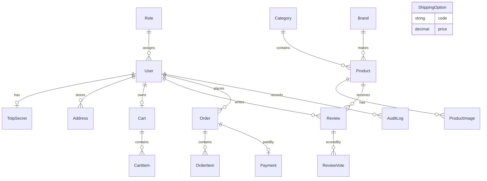

# Volt & Co — I Love Shopping (Part 3)

A B2C electronics shop is provided: accounts, a PostgreSQL catalog, faceted search, reviews, admin, and a Next.js storefront behind **self-signed TLS**. This repository is **Project 3 (Experience)** of three. Cart, checkout, Stripe sandbox payments, RabbitMQ, and encrypted addresses from Part 2 are retained.

## Stack

- **API:** Express + TypeScript
- **Web:** Next.js 15 App Router (`apps/storefront`) on 8088 / 8443 — SSR catalog, client checkout/admin
- **Web (leftover):** React 19 + Vite (`apps/web`) for local `pnpm dev:web` on 5173; Docker does not serve this app
- **Edge:** nginx TLS terminator (`https://localhost:8443`) proxies to the Next storefront
- **Data:** PostgreSQL (Prisma, ACID transactions) + Redis (refresh sessions + token-bucket rate limits)
- **Mail:** Nodemailer → Mailpit (Docker)
- **Payments:** Stripe test mode + Payment Element (card data is never sent to the API)
- **Queue:** RabbitMQ + `apps/worker` (payment status → email + inventory)
- **Carriers:** Posti, PostNord, and Budbee adapters (mock labels by default; live mode is enabled with env credentials)
- **Load:** k6 (`load-tests/shop.js`) — report in [docs/PERFORMANCE.md](docs/PERFORMANCE.md)
- **Staff Admin:** tab-by-tab guide and roles in [docs/USER_MANUAL.md](docs/USER_MANUAL.md)
- **BI / integrations:** SQL views + machine API keys + signed webhooks — [docs/INTEGRATIONS.md](docs/INTEGRATIONS.md)
- **Monorepo:** pnpm workspaces (`apps/api`, `apps/web`, `apps/storefront`, `apps/worker`, `packages/shared`)

## Entity relationship diagram

Reviews, carts, orders, and staff audit are stored in PostgreSQL. Refresh sessions are kept in Redis (not shown). Full diagrams: [docs/erd.md](docs/erd.md).



Refresh tokens are **not** stored in Postgres. A Redis family (`rf:{familyId}` → current `jti`) is created on each login. A new `jti` is written on every refresh (single use). The whole family is revoked if an old refresh token is replayed. Access tokens are JWTs held **only in React memory** (`apps/storefront/components/auth.tsx`); on logout the access `jti` is placed on a Redis denylist until expiry.

Guest carts use an httpOnly `cart_token` cookie. The raw token is never stored — only its SHA-256. On sign-in that cart is merged into the user cart and quantities are clamped to stock. Shipping addresses are encrypted at rest with AES-256-GCM (`DATA_ENCRYPTION_KEY`).

TOTP is required for staff roles (`admin`, `support`, `sales`, `warehouse`). Customer accounts cannot be promoted. New staff are created with 2FA already on. Reviews are **purchased-only** and are sorted by helpfulness.

## Setup (Docker starts the stack; Stripe test keys are needed to demo checkout)

```bash
./scripts/start.sh
```

or:

```bash
cp .env.example .env
docker compose up --build
```

| Service | URL |
| --- | --- |
| Storefront (HTTP) | http://localhost:8088 |
| Storefront (TLS, self-signed) | https://localhost:8443 |
| API health | http://localhost:3000/api/v1/health |
| API docs (Swagger) | http://localhost:3000/api/v1/docs |
| OpenAPI spec | http://localhost:3000/api/v1/openapi.json |
| Mailpit | http://localhost:8025 |
| RabbitMQ management | http://localhost:15672 (`guest` / `guest`) |
| Postgres (host) | `localhost:15432` |
| Redis (host) | `localhost:6379` |

Accept the browser warning on **8443** — the certificate is generated inside the `tls` container for local review.

Google reCAPTCHA **test keys** are included in `.env.example` so registration and the contact form work on localhost without a Google Cloud project.

The API seed is run on container start **only when the catalog is empty**. Demo addresses and 2FA are not wiped on restart. A full reseed is done by dropping the Postgres volume.

If RabbitMQ still exits with `.erlang.cookie: eacces` (leftover volume from an older compose file):

```bash
docker compose down
docker volume rm i-love-shopping3_rabbitmq_data 2>/dev/null || true
./scripts/start.sh
```

### Demo accounts

| Email | Password | Notes |
| --- | --- | --- |
| `customer@volt.test` | `Shopping123` | Pre-verified customer; has a delivered Sony WH-1000XM5 order so they can leave a review |
| `admin@volt.test` | `Shopping123` | Full admin. **TOTP required** — add secret `DEMOADMIN2FASECRETKEYAA` in Google Authenticator / Authy |
| `support@volt.test` | `Shopping123` | Orders, refunds, review moderation (same TOTP secret) |
| `sales@volt.test` | `Shopping123` | Catalog and shipping (same TOTP secret) |
| `warehouse@volt.test` | `Shopping123` | Products, orders, and order handling only (same TOTP secret) |

Registering a new user sends a link to Mailpit.

### Google OAuth (optional to use, mandatory for completion of the project)

Set `GOOGLE_CLIENT_ID` and `GOOGLE_CLIENT_SECRET` in `.env`. Authorized redirect URI:

`http://localhost:3000/api/v1/auth/google/callback`

If those variables are empty, email-password sign-in is still available and the Google button is hidden. Staff accounts are signed in with email + 2FA (not Google). After the password is accepted, a new two-factor form is mounted so the email and password are not left in the authenticator fields.

### Stripe (sandbox)

Use provided .env (shared in chat) or add your own **test** keys from the Stripe Dashboard to `.env`, then recreate the API container:

```bash
# .env
STRIPE_SECRET_KEY=sk_test_...
STRIPE_PUBLISHABLE_KEY=pk_test_...
STRIPE_WEBHOOK_SECRET=whsec_...   # from Stripe CLI, optional if you use /checkout/orders/:id/sync
```

Host extra (optional, for live webhooks): [Stripe CLI](https://stripe.com/docs/stripe-cli)

```bash
stripe listen --forward-to localhost:3000/api/v1/webhooks/stripe
```

Without the CLI, the storefront still confirms payment by retrieving the PaymentIntent from Stripe (`POST /checkout/orders/:id/sync`) after both a successful pay and a declined card (for example `4000…9995`). Incomplete card fields stay on the Pay form. The webhook publishes that status to RabbitMQ; the worker marks the order paid or failed, sends Mailpit mail, and restores stock on failure. The same handler runs in-process during automated tests (`QUEUE_INLINE`).

**Test cards** (any future expiry, any CVC):

| Result | Number |
| --- | --- |
| Success | `4242 4242 4242 4242` |
| Insufficient funds | `4000 0000 0000 9995` |
| Expired card | `4000 0000 0000 0069` |
| Generic decline | `4000 0000 0000 0002` |

Simulate a gateway timeout in non-production with header `X-Volt-Simulate: stripe-timeout` on `POST /checkout/place`.

**PCI DSS talking point:** **SAQ A** is targeted. Checkout is handled through Stripe.js / Payment Element. PAN, expiry, and CVC are never posted to Express, never written to logs, and never stored in Postgres. Only Stripe PaymentIntent ids and encrypted order snapshots are stored. Public TLS is the `tls` nginx service.

## Local development (optional)

Needs Docker only for Postgres, Redis, Mailpit, and RabbitMQ:

```bash
docker compose up -d postgres redis mailpit rabbitmq
cp .env.example apps/api/.env
# In apps/api/.env set MAIL_PORT=10250 and DATABASE_URL to port 15432
# Leave RABBITMQ_URL empty (or QUEUE_INLINE=true) if you are not running the worker
pnpm install
pnpm --filter @volt/shared build
pnpm --filter api exec prisma migrate deploy
pnpm --filter api seed
pnpm dev:api   # http://localhost:3000
pnpm --filter worker dev
pnpm dev:web   # http://localhost:5173 — leftover Vite SPA
pnpm dev:storefront   # http://localhost:3001 — Next.js storefront
```

The Next storefront is served by `./scripts/start.sh` on 8088 / 8443. Home, catalog, and product HTML (title, description, JSON-LD) are server-rendered. `/api` is proxied to Express so guest `cart_token` cookies stay same-origin. Checkout, orders, account, and staff admin are client islands. Local Next without Docker is started with `pnpm dev:storefront` on 3001 (API on 3000). The Vite app on 5173 is retained as a leftover SPA and is not used in Docker.

## Usage

1. Open **https://localhost:8443** (accept the self-signed warning) or http://localhost:8088. Home shows featured products and collections.
2. Browse **Catalog**. Filter by category, brand, price, and rating; switch grid/list; paginate; sort by relevance, price, or rating. Header search offers live suggestions on every page. Header **Cart** opens a quick-bag preview.
3. Open a product: full-size photo plus thumbnail, metric **and** imperial weight/dimensions, stock, attributes, **reviews** (sorted by helpful votes), related products. Catalog images are Unsplash/Pexels lifestyle shots, with derived 400px thumbs and ~1200px full sizes. Credits: [CREDITS.md](apps/api/prisma/seed-images/CREDITS.md).
4. Sign in as `customer@volt.test` and review the seeded Sony WH-1000XM5 (already purchased). Vote a review helpful; the average on the product updates.
5. Open **Cart**. Change quantities (live totals), hit a stock limit, refresh as a guest — the bag stays. Sign in: the guest bag merges into your account cart.
6. **Checkout** is one page: contact, shipping and billing addresses (Finnish postcodes, US ZIP, and other offline checks), shipping options from the database, live summary (retail prices include 25.5% Finnish VAT, shown as its own row), then Stripe Payment Element. Confirmation shows a `VC-…` reference, order ID, VAT line, and estimated delivery window.
7. **Profile** (signed-in name menu): edit display name, 2FA, saved addresses. **Orders** (same menu) lists the full history with status/date filters.
8. **Admin** (`admin@volt.test` + TOTP): products are created, edited, and deleted; images are uploaded; warehouse locator codes (`01|02|2|1`), barcodes (EAN-13), and **Receive stock** scan-in are used; retail / wholesale / VAT / margin are shown on each product; a wholesaler is assigned per product; **wholesalers** lists suppliers and emails a restock purchase order to Mailpit; categories are managed; bulk CSV/JSON is imported; **Reports** covers shop-wide money (**overview**), product/category **sales**, and **customers**; sales is filtered by product or category and by last week/month/12 months or calendar week/month/year; **order handling** lists paid work oldest first (Process → tick lines or optional barcode scan → confirm pick → Print label → Hand to courier); order status and refunds are applied to any paid-through-delivered order with a reason; **users** adds employees with a password and 2FA already on (customer roles stay locked; staff role changes ask for confirmation); reviews are hidden or published; shipping prices/days/active are edited; **integrations** issues machine API keys and signed webhooks for BI tools. Print label uses the Posti / PostNord / Budbee mock adapters by default.
9. **About**, **Contact** (CAPTCHA → Mailpit), **FAQ**, **Terms**, and a **404** catch-all.
10. Create an account (CAPTCHA required), confirm via Mailpit, sign in. Access tokens never go to `localStorage`. Staff accounts are created under Admin → users, not by promoting a customer.
11. Explore endpoints at **http://localhost:3000/api/v1/docs**. Burst login/contact traffic returns **429** (Redis token bucket; skipped in automated `NODE_ENV=test` except unit tests).

### Carrier shipping (mock today)

**Print label** on Order handling calls `POST /api/v1/admin/orders/{id}/shipment`. A carrier adapter is selected. The order is mapped to that carrier’s developer-portal request shape, then:

- `*_MODE=mock` (default) — a Volt printable HTML label and a demo tracking code are generated. A carrier account is not required.
- `*_MODE=live` plus that carrier’s credentials — the same request shape is sent to the live API.

| Carrier | Mock tracking | Live products | Switch |
| --- | --- | --- | --- |
| Posti | `JJFI…` | **2104** Home / **2102** Express (Nextshipping) | `POSTI_MODE=live` + `POSTI_CLIENT_ID` / `POSTI_CLIENT_SECRET` |
| PostNord | `00TEST…` | **17** Home / **18** Parcel (Booking API) | `POSTNORD_MODE=live` + `POSTNORD_CLIENT_ID` / `POSTNORD_CLIENT_SECRET` |
| Budbee | `BUD-DEV-…` | **HOME** (Multiple Orders v2) | `BUDBEE_MODE=live` + `BUDBEE_API_KEY` / `BUDBEE_API_SECRET` |

### Posti tracking (reviewer sample)

The same value is used as the Admin **Courier** field placeholder. When it is pasted for a Posti hand-off, a working Posti tracking URL is built.

```
JJFI66012700410158170/32109367922
```

Opens: https://www.posti.fi/en/tracking/JJFI66012700410158170/32109367922

## Bonus features (beyond the Part 3 mandatory list)

These extras can be opened by a reviewer without extra setup. They are **not** required by the checklist; they are listed so additions on top of the mandatory items are visible.

| Bonus | Where to see it | What it does |
| --- | --- | --- |
| Staff **change log** | Admin → **log** (`admin@volt.test`) | Encrypted audit rows for product, category, order, review, user-role, and shipping edits |
| **Shipped** email + tracking | Admin → hand an order to the courier; Mailpit + order page | HTML mail with carrier link, ETA, and a tracking modal on the order |
| Finland carrier URLs | Ship with Posti / PostNord / Budbee | Posti uses `/en/tracking/{code}/{id}`; sample code `JJFI66012700410158170/32109367922` (same as the Courier placeholder). Other carriers open their official pages |
| Staff **roles** | `admin` / `support` / `sales` / `warehouse` demo accounts | RBAC: catalog vs orders/refunds vs reviews vs shipping vs warehouse floor; customer roles stay locked |
| **FAQ** and **Terms** | Header/footer | Extra content pages (About / Contact / 404 are mandatory; these two are extra) |
| Separate **billing** address | Checkout | Optional billing block when “same as shipping” is unchecked |
| Human **`VC-…` references** | Confirmation and order email | Short storefront reference next to the UUID |
| **Related products** | Cart and product page | Same category or brand recommendations |
| Branded **failed-payment** HTML | Decline `4000…9995`; Mailpit | Same template as the paid confirmation, with decline reason and Return to cart |
| Seed **does not wipe** demo data | Restart the API | `prisma db seed` no-ops once products exist so 2FA and addresses survive |
| **OpenAPI / Swagger** | http://localhost:3000/api/v1/docs | Try-it-out for catalog, cart, checkout, reviews, and admin |
| Header **quick bag** + typeahead | Every page | Mandatory chrome; listed here because it is easy to miss on first load |

Mandatory Part 3 items (reviews, admin CRUD, TLS, k6, rate limits, derived images, home/about/contact/404, and so on) are in the sections above, not in this table.

## Tests

From the repo root (API image includes Vitest). Unit tests always run. API/security tests run when Postgres + Redis are reachable:

```bash
docker compose exec api pnpm test
```

or locally after dependencies are up:

```bash
pnpm test
```

Load:

```bash
docker compose --profile load run --rm --no-deps k6
# optional: find the p95 > 5s breaking point
docker compose --profile load run --rm --no-deps -e K6_PROFILE=stress k6
```

Storefront smoke (Playwright; needs the stack on :8088):

```bash
pnpm exec playwright install chromium
pnpm test:e2e
```

Coverage:

- **Unit:** JWT generate/validate/expire, refresh rotation + reuse, input validation, product model, cart totals, address encryption, review averages, token-bucket, Posti / PostNord / Budbee mock adapters
- **API:** register/login/refresh/revoke, catalog fields, facets, sort, suggestions, images, OpenAPI document, guest cart, merge on login, checkout validation, Stripe place + webhook (inline queue), concurrent last-unit checkout, order list/cancel/refund, purchased-only reviews + helpful votes, admin 2FA + CRUD + bulk JSON + shipment labels
- **Security:** parameterized search (injection payload), malformed JSON, unauthenticated `/me` and `/admin`, token-bucket HTTP 429, encrypted address columns, TOTP secrets, and refresh JTIs (`v1:` AES-GCM)
- **E2E:** Playwright smokes for home, catalog, about, 404, and header search (`pnpm test:e2e`)

## Review talking points

Written explanations (JWT, ACID, Postgres growth, search, cart/checkout/payment tests, architecture, PCI, **CIA**, semantic HTML, load) are in [docs/REVIEW_EXPLANATIONS.md](docs/REVIEW_EXPLANATIONS.md).

## Performance analysis

k6 scenarios in `load-tests/shop.js` (browse, search+cart, login). Full write-up: [docs/PERFORMANCE.md](docs/PERFORMANCE.md).

| Objective | Target | Last measured (Compose, 2026-09-14) |
| --- | --- | --- |
| 90% of requests | within 2s | **p90 = 59 ms** |
| Concurrent users | ≥ 50 without collapse | 50 browse VUs; p95 = 103 ms |
| Peak throughput | ≥ 10 TPS | **112 HTTP req/s** |
| Error rate | < 5% | **0%** (9049/9049) |
| Max VUs before p95 > 5s | identify | Not reached at 64 VUs |
| Bottlenecks | catalog facets, Argon2 login, image origin | Redis facet cache, more API replicas, nginx static files |

## Architecture notes

A modular monolith is used: an Express API plus a RabbitMQ worker process from the same image (`node dist/worker.js`). nginx terminates TLS and proxies to the Next.js storefront (`apps/storefront`). PostgreSQL is the system of record (transactions, `SELECT FOR UPDATE` on checkout). Redis holds hot session state and rate-limit buckets. Stripe webhooks publish `payment.status`; email is sent and inventory is adjusted by the worker. Failed handler messages are sent to `payment.status.dlq`. Parcel labels are created through carrier adapters under `apps/api/src/lib/carriers/` (Posti Nextshipping, PostNord Booking, Budbee Multiple Orders). Mock mode is the default.
