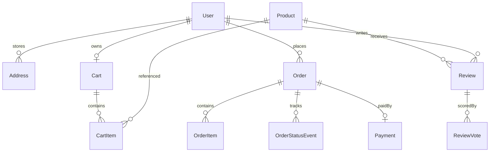

# Entity relationship diagrams

Cardinality: `1` = one, `*` = many. Modality: a `0..1` relationship is optional.

## Part 1 — implemented

```mermaid
erDiagram
  Role ||--o{ User : assigns
  User ||--o| TotpSecret : has
  User ||--o{ OAuthIdentity : links
  User ||--o{ PasswordResetToken : requests
  User ||--o{ EmailVerificationToken : confirms
  Category ||--o{ Product : contains
  Category ||--o{ Category : parent
  Brand ||--o{ Product : makes
  Product ||--o{ ProductImage : has
  Product ||--o{ ProductAttribute : has

  Role {
    uuid id PK
    string name UK
  }
  User {
    uuid id PK
    string email UK
    string passwordHash
    uuid roleId FK
    boolean totpEnabled
  }
  TotpSecret {
    uuid id PK
    uuid userId FK
    string secret
    json backupCodes
  }
  OAuthIdentity {
    uuid id PK
    uuid userId FK
    string provider
    string providerUserId
  }
  Category {
    uuid id PK
    string slug UK
    uuid parentId FK
  }
  Brand {
    uuid id PK
    string slug UK
  }
  Product {
    uuid id PK
    string slug UK
    decimal price
    int stockQuantity
    uuid categoryId FK
    uuid brandId FK
    decimal weightKg
    decimal weightLb
    decimal lengthCm
    decimal widthCm
    decimal heightCm
    decimal lengthIn
    decimal widthIn
    decimal heightIn
    float averageRating
  }
  ProductImage {
    uuid id PK
    uuid productId FK
    string path
    string altText
  }
```

Refresh sessions (access `jti` denylist, rotating refresh `fam`/`jti`) live in **Redis**, not PostgreSQL, so rotation and revocation stay O(1) and single-use.

## Full platform (Part 2/3 — planned)

