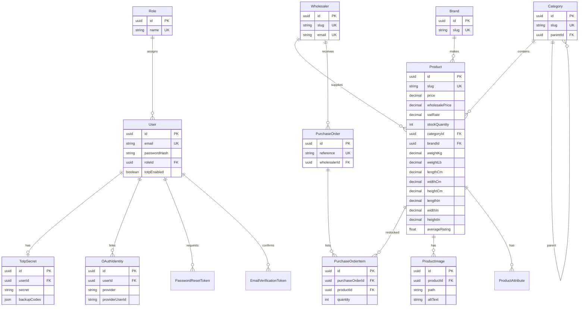
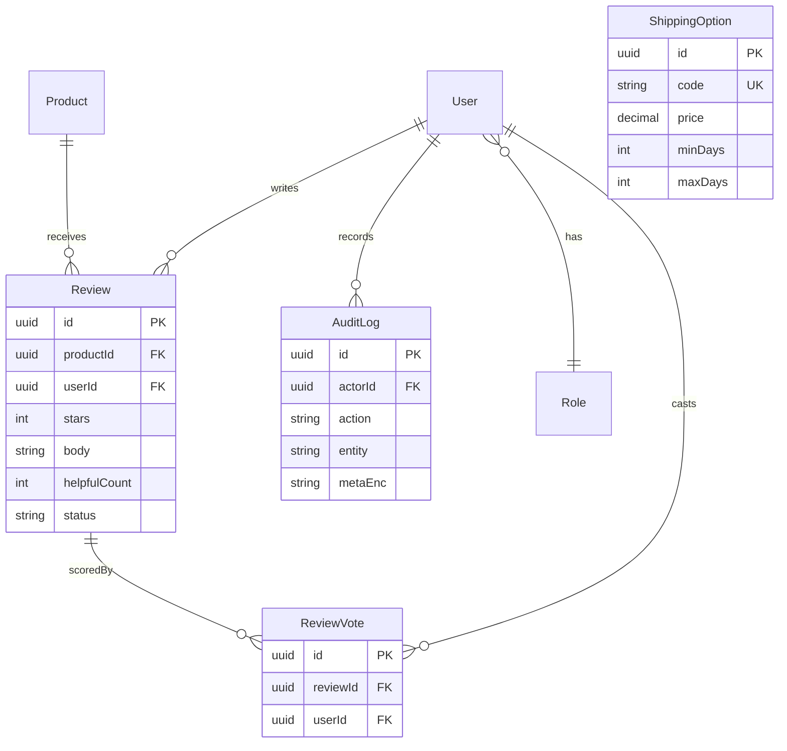

# Entity relationship diagrams

Cardinality: `1` = one, `*` = many. Modality: a `0..1` relationship is optional.

## Part 1 — implemented

Refresh sessions (access `jti` denylist, rotating refresh `fam`/`jti`) live in **Redis**, not PostgreSQL, so rotation and revocation stay O(1) and single-use.

## Part 2 — commerce (implemented)

Guest carts are keyed by an httpOnly `cart_token` cookie (hashed in Postgres, 30-day TTL). Logged-in users have one persistent cart. Login merges the guest cart and clamps quantities to stock. Address, contact, and payment metadata columns store AES-256-GCM ciphertext. Stripe payment outcomes are published to RabbitMQ (`payment.status`); the worker consumes them, emails the shopper, and restores stock on failure. Poison messages dead-letter to `payment.status.dlq`.

```mermaid
erDiagram
  User ||--o{ Address : stores
  User ||--o| Cart : owns
  Cart ||--o{ CartItem : contains
  Product ||--o{ CartItem : referenced
  User ||--o{ Order : places
  Order ||--o{ OrderItem : contains
  Order ||--o{ OrderStatusEvent : tracks
  Order ||--o| Payment : paidBy
  Order }o--o| Address : shipsTo
  Product ||--o{ OrderItem : referenced
  Product ||--o{ InventoryReservation : reservedBy
  Order ||--o{ InventoryReservation : holds

  Address {
    uuid id PK
    uuid userId FK
    string recipientNameEnc
    string line1Enc
    string cityEnc
    string postalEnc
    string country
  }
  Cart {
    uuid id PK
    uuid userId FK
    string guestToken UK
    datetime expiresAt
  }
  CartItem {
    uuid id PK
    uuid cartId FK
    uuid productId FK
    int quantity
  }
  Order {
    uuid id PK
    uuid userId FK
    string status
    decimal total
    string shippingAddressEnc
    string contactEmailEnc
  }
  OrderItem {
    uuid id PK
    uuid orderId FK
    uuid productId FK
    int quantity
    decimal unitPrice
  }
  Payment {
    uuid id PK
    uuid orderId FK
    string stripePaymentIntentId
    string status
    string metadataEnc
  }
```

## Part 3 — implemented

Reviews are purchased-only (`PAID` / `PROCESSING` / `SHIPPING` / `WITH_COURIER` / `DELIVERED`). Helpful votes are unique per user. Product `averageRating` / `reviewCount` are recalculated from published reviews. Staff actions write an encrypted audit row. Shipping options are editable in admin.

